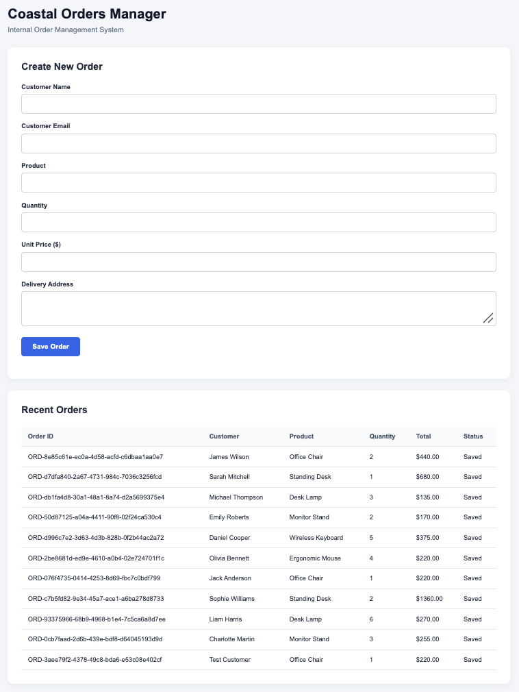
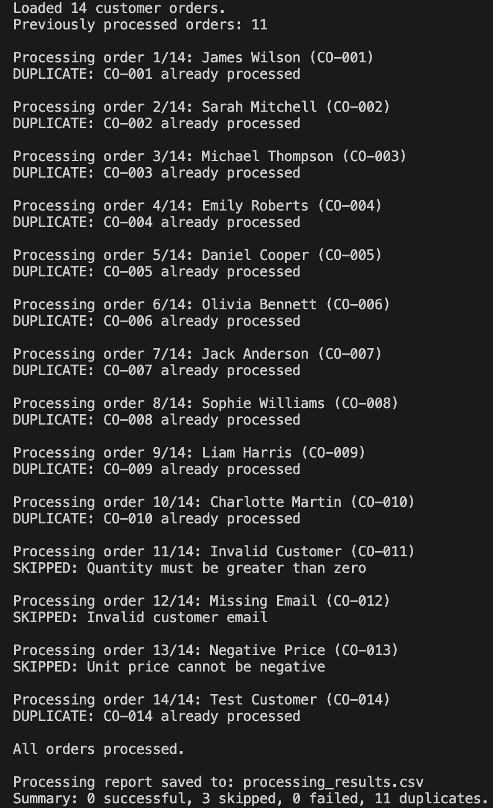
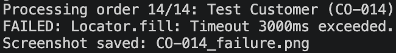

# Automated Business Data Entry Bot

A Python-based Robotic Process Automation (RPA) system that automatically transfers customer order data from CSV files into a web-based business application.

This project demonstrates how repetitive administrative tasks can be automated using browser interaction, data validation, duplicate prevention, error handling, and execution reporting.

The automation was developed using Python and Playwright, with a custom-built order management website used to simulate a real business environment.

## Business Problem

Many businesses rely on employees to manually transfer information between spreadsheets, emails, and internal software systems.

For example, a wholesale business might receive customer orders in a spreadsheet and require an employee to enter each order individually into an internal order management system.

This process can be:

- **Time-consuming:** Employees repeatedly copy and paste customer information.
- **Error-prone:** Manual entry can introduce mistakes in quantities, prices, or customer details.
- **Repetitive:** Staff spend time on administrative tasks instead of higher-value work.
- **Difficult to monitor:** Without automated reporting, tracking completed and failed entries can be challenging.

These problems are particularly relevant when businesses use older software or internal systems that do not provide APIs for direct integration.

## Solution

I developed an RPA bot that automatically reads customer orders from a CSV file and enters them into a simulated internal order management website.

Instead of requiring a person to manually complete each form, the bot interacts with the website through a browser, just as a human employee would.

The system also validates incoming data, prevents previously completed orders from being submitted again, records processing results, and handles unexpected browser errors.

This demonstrates how RPA can automate workflows even when direct API integration is unavailable.

## Technologies Used

- **Python:** Core automation logic, CSV processing, validation, and reporting.
- **Playwright:** Browser automation and interaction with website elements.
- **HTML:** Structure of the simulated order management website.
- **CSS:** Styling and layout of the internal business application.
- **JavaScript:** Website form handling, order calculations, and browser storage.
- **CSV:** Input data and exported processing reports.
- **JSON:** Persistent tracking of successfully processed order references.
- **Git & GitHub:** Version control and project documentation.

## How the Automation Works

### 1. Read Customer Orders

The bot loads customer order information from `data/orders.csv`.

Each order contains:

- Unique order reference
- Customer name
- Customer email
- Product
- Quantity
- Unit price
- Delivery address

### 2. Check for Duplicates

Before processing an order, the bot checks its unique reference against previously completed orders stored in `processed_orders.json`.

If the reference has already been processed successfully, the bot skips it.

This prevents previously completed orders from being resubmitted when the automation is run again.

### 3. Validate Order Information

The bot checks incoming order data before entering it into the website.

Validation includes:

- Required customer information
- Basic email format
- Required product information
- Positive order quantities
- Non-negative unit prices
- Required delivery addresses

Orders that fail validation are skipped and recorded with an explanation.

### 4. Automate Website Data Entry

For valid orders, Playwright launches a Chromium browser and interacts with the order management website.

The bot automatically:

1. Opens the internal order management application.
2. Locates the relevant form fields.
3. Enters customer and product information.
4. Submits the completed order.
5. Reads the website's confirmation message.
6. Extracts the generated order ID.

This replicates the repetitive browser interactions normally performed by an employee.

### 5. Record Successful Orders

After receiving a successful submission confirmation, the bot saves the order reference to `processed_orders.json`.

This information persists between executions, allowing the automation to recognise previously completed orders.

Failed or invalid orders are not marked as successfully processed.

### 6. Handle Website Errors

If Playwright encounters an unexpected browser error, such as a missing form element or timeout, the bot:

- Catches the error without terminating the entire order-processing loop.
- Marks the affected order as failed.
- Records the error details.
- Attempts to capture a screenshot for troubleshooting.
- Continues processing subsequent orders.

Failed orders remain eligible for processing during a later execution.

### 7. Generate a Processing Report

After processing the orders, the bot exports `processing_results.csv`.

The report includes:

- Order reference
- Customer name
- Processing status
- Generated order ID, where available
- Processing details or error explanation

The bot also prints an execution summary showing the number of successful, skipped, failed, and duplicate orders.

## Screenshots

### Order Management Website

The simulated Coastal Orders Manager application, showing the order-entry form and successfully saved customer orders.



### Automated Processing and Duplicate Prevention

Terminal output demonstrating order processing, duplicate detection, data validation, and execution reporting.



### Website Error Handling

A controlled test demonstrating how the bot detects and records an unexpected browser automation failure.



## Testing and Results

The automation was tested using 14 fictional customer orders.

Testing covered successful order entry, invalid data, duplicate prevention, browser failures, and retrying a previously failed order.

| Test Scenario | Result |
|---|---|
| Process 10 valid customer orders | Passed |
| Reject 3 invalid customer orders | Passed |
| Detect previously completed orders | Passed |
| Prevent duplicate submissions on subsequent runs | Passed |
| Detect an invalid website selector | Passed |
| Record browser errors without crashing the processing loop | Passed |
| Capture a screenshot following a browser error | Passed |
| Successfully process an order that previously failed | Passed |
| Generate a CSV processing report | Passed |

During the final duplicate-prevention test, the bot identified 11 previously completed orders, skipped 3 invalid orders, and created no additional orders.

The browser failure test also demonstrated that an unsuccessful order could be processed successfully during a subsequent execution after the issue was corrected.

## Project Structure

- `bot/main.py` — Main Python RPA automation.
- `website/index.html` — Simulated internal order management application.
- `website/style.css` — Website styling.
- `website/script.js` — Form submission, order calculations, and browser storage.
- `data/orders.csv` — Sample customer orders.
- `screenshots/` — Project screenshots and testing evidence.
- `requirements.txt` — Python dependencies.
- `.gitignore` — Excluded local and generated files.
- `README.md` — Project documentation.

The automation also generates `data/processed_orders.json` and `data/processing_results.csv` during execution. These files are excluded from version control.

## How to Run

### 1. Clone the Repository

Clone the repository and open the project directory.

### 2. Create a Python Virtual Environment

```bash
python3 -m venv .venv
```

Activate the virtual environment:

**macOS/Linux:**

```bash
source .venv/bin/activate
```

**Windows:**

```bash
.venv\Scripts\activate
```

### 3. Install Dependencies

```bash
pip install -r requirements.txt
```

Install the Chromium browser used by Playwright:

```bash
python -m playwright install chromium
```

### 4. Review the Sample Orders

Open `data/orders.csv` to review the fictional customer orders.

The file includes valid orders and intentionally invalid examples used to demonstrate validation.

### 5. Run the Automation

From the project root directory:

```bash
python bot/main.py
```

The bot will launch Chromium, open the simulated order management website, and begin processing the orders.

### 6. Review the Results

After execution, review:

- The terminal execution summary.
- `data/processing_results.csv` for individual order outcomes.
- `data/processed_orders.json` for successfully processed order references.
- The Recent Orders table in the browser.

Running the automation again demonstrates duplicate prevention.

## Skills Demonstrated

### Robotic Process Automation (RPA)

Developed a bot capable of interacting with a browser-based business application to automate repetitive data-entry tasks.

### Browser Automation

Used Playwright to locate website elements, populate forms, submit information, and verify successful interactions.

### Data Processing and Validation

Implemented CSV ingestion and Python validation to identify incomplete or invalid business records before submission.

### Duplicate Prevention

Implemented persistent order-reference tracking to prevent previously completed orders from being submitted again during subsequent executions.

### Error Handling and Recovery

Implemented browser exception handling, failure reporting, screenshot capture, and support for retrying unsuccessful orders.

### Automation Monitoring and Reporting

Generated structured CSV reports and execution summaries to make automation results visible and auditable.

### Full-Stack Development

Built a simulated internal business application using HTML, CSS, and JavaScript to provide a realistic environment for developing and testing the automation.

## Business Applications

The techniques demonstrated in this project could be adapted to automate a range of repetitive business processes.

Examples include:

- **Order Processing:** Transferring customer orders from spreadsheets into internal order management systems.
- **CRM Data Entry:** Creating or updating customer records in browser-based CRM applications.
- **Inventory Management:** Entering stock updates and product information into inventory software.
- **Invoice Processing:** Transferring invoice details into accounting or administrative systems.
- **Legacy Software Automation:** Interacting with older business applications that lack accessible APIs.
- **Administrative Workflows:** Automating repetitive form submissions and record updates across internal systems.

By automating these processes, businesses can reduce manual administrative work, improve consistency, and allow employees to focus on tasks that require human judgement.

## Limitations and Future Improvements

This project is a working demonstration built around a simulated internal business application rather than a production business system.

Potential improvements for a real-world deployment include:

- Scheduling the automation to run automatically.
- Adding automatic retries for temporary website failures.
- Checking the destination system for existing records before submission.
- Implementing stronger input validation and transaction verification.
- Adding email or messaging alerts when failures occur.
- Supporting authentication and secure credential management.
- Deploying the bot on a dedicated machine or managed automation platform.
- Implementing centralised logging and monitoring.

These improvements would help make the automation more reliable and suitable for production environments.

## Key Takeaway

This project demonstrates my ability to design and build an RPA solution that automates repetitive browser-based business workflows.

Rather than simply scripting mouse clicks, the system combines data processing, validation, persistent state tracking, browser automation, error handling, and reporting.

The same approach can be adapted to real business processes where employees repeatedly transfer information between spreadsheets and internal software, particularly when direct API integrations are unavailable.